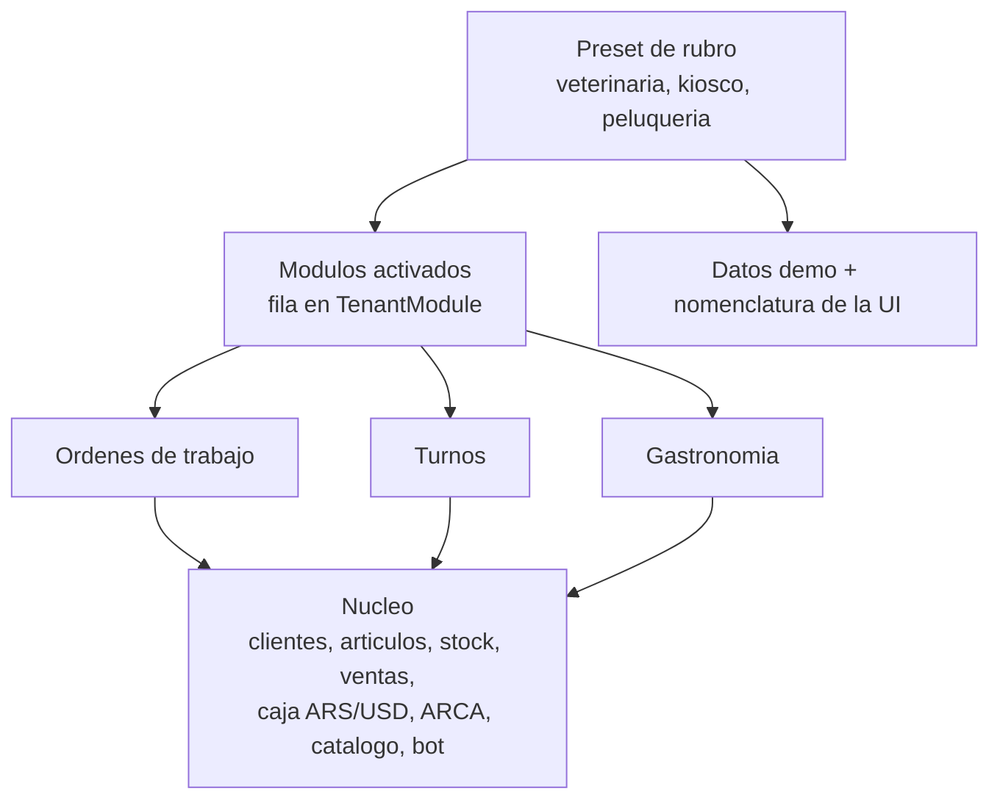
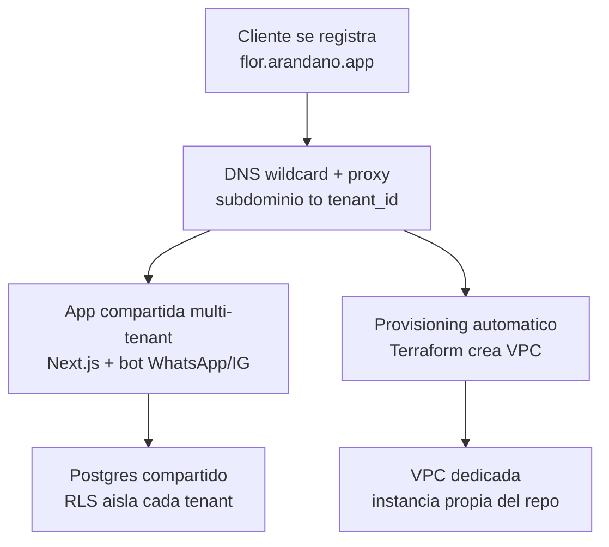

# Arándano — contexto del proyecto

Este documento resume las decisiones de producto y arquitectura ya tomadas para Arándano, de forma que cualquier trabajo futuro (incluido Claude Code) parta de este contexto en vez de re-discutir decisiones ya cerradas.

## Qué es Arándano

Plataforma de gestión para cualquier tipo de negocio del mercado argentino. Conecta en un solo lugar: ventas, stock/inventario, caja en pesos y dólares, clientes, facturación ARCA, catálogo público y un bot de WhatsApp/Instagram conectado a los datos reales del negocio (stock, precios, seguimiento de ventas frías, pedido de reseñas).

Sobre esa base, cada rubro suma lo suyo: órdenes de trabajo para servicio técnico y oficios, agenda para servicios con turno, mesas y comandas para gastronomía. El primer vertical que se implementa es locales de celulares, tecnología y servicio técnico — es el mercado que ya está validado —, pero el sistema se diseña desde el inicio para el resto.

Planes comerciales: Básico, Negocio, Profesional (más elegido, incluye bot) y Premium (a medida, infraestructura dedicada).

## Arquitectura de producto: núcleo, módulos y presets de rubro

La plataforma sirve a cualquier rubro sin convertirse en un genérico configurable. Se apoya en tres piezas.

**Núcleo.** Lo que todo negocio necesita y no cambia de rubro a rubro: tenant, usuarios y roles, clientes, catálogo de artículos (productos con stock y servicios sin stock), inventario, ventas, caja en pesos y dólares, facturación ARCA, catálogo público, bot y jobs en background. El núcleo solo, sin activar ningún módulo, ya cubre un comercio de retail completo (kiosco, ropa, ferretería, dietética, pet shop).

**Módulos.** Código que agrega comportamiento nuevo, activable por tenant. Son pocos, y eso es deliberado:

| Módulo | Qué agrega | Rubros que habilita |
|---|---|---|
| **Órdenes de trabajo** | Ciclo ingreso → diagnóstico → presupuesto → aprobación del cliente → ejecución con repuestos → cierre y cobro | Servicio técnico, celulares, electricista, plomero, refrigeración, obra chica |
| **Turnos** | Agenda, disponibilidad, recursos y profesionales asignados, reserva y recordatorio automático | Peluquería, estética, consultorio, taller mecánico, veterinaria |
| **Gastronomía** | Mesas, comandas, pantalla de cocina, recetas que descuentan insumos | Bar, cafetería, restó, delivery |

**Presets de rubro.** Un rubro no es código: es un archivo de configuración que declara qué módulos vienen activados, qué datos demo se cargan y cómo se nombran las cosas en la UI. Agregar "veterinaria" (núcleo + turnos) o "dietética" (sólo núcleo) no requiere desarrollo. Por eso la promesa de "cualquier tipo de negocio" es sostenible: los rubros son ilimitados, los módulos son tres.

Decisiones asociadas, ya cerradas:

- **Un tenant activa varios módulos, no uno.** El propio local de celulares es núcleo + órdenes de trabajo; una veterinaria es núcleo + turnos. El modelo nunca asume un único rubro por tenant.
- **Reparaciones y oficios son el mismo módulo.** Un service de celulares y un electricista comparten el mismo ciclo de trabajo; la diferencia (mostrador vs. domicilio, equipo con IMEI o sin él) son campos y estados del preset, no un módulo aparte.
- **Los módulos no se cobran aparte ni se atan al plan.** Cualquier tenant activa lo que necesite; el plan limita capacidad y features transversales (usuarios, sucursales, bot, ARCA, reportes). Un consultorio chico no debe subir de plan sólo para tener agenda.
- **Mecanismo: monolito modular con registry.** Cada módulo vive en `modules/<nombre>/` con su schema de Prisma, rutas, UI y jobs, más un `module.ts` que declara qué aporta. La activación es una fila en `TenantModule`. Un solo repo y un solo deploy, coherente con el VPS único y el Docker Compose ya elegidos.

El núcleo expone puntos de extensión explícitos, y los módulos sólo pueden engancharse ahí: navegación, tipos de artículo, generación de ventas (`crearVentaDesde`), movimientos de stock, intents del bot, jobs de pg-boss, vistas del catálogo público y datos demo de onboarding. Un módulo que necesite algo fuera de esa lista es señal de que falta un punto de extensión en el núcleo — no de que haya que saltearlo.

## Modelo SaaS y multi-tenancy

- Cada cliente (el negocio, sea del rubro que sea) es un **tenant**, identificado por subdominio: `flor.arandano.app`.
- La mayoría de los planes (trial, Básico, Negocio, Profesional) **comparten una única aplicación y una única base de datos Postgres**, aislados lógicamente por columna `tenant_id` + Row Level Security. El registro de un cliente nuevo es instantáneo: crear fila de tenant + datos demo, sin tocar infraestructura.
- El plan **Premium** es la excepción: dispara un flujo de *provisioning* automatizado (Terraform) que levanta una instancia con **VPC dedicada** para ese cliente. Este es un upsell consciente, no el default.
- Un tenant que crece y necesita aislarse más adelante se migra de "fila en Postgres compartido" a "VPC dedicada" — tenerlo en cuenta en el diseño del modelo de datos para que exportar/migrar un tenant sea limpio (ya prometemos 30 días de exportación de datos al cliente).

## Stack tecnológico elegido

| Pieza | Elección | Motivo |
|---|---|---|
| Framework full-stack | **Next.js (App Router) + TypeScript** | Un solo lenguaje front/back, ecosistema React rico para dashboards, corre como servidor Node propio (no serverless) para sostener websockets |
| Componentes de UI | **shadcn/ui** sobre Tailwind | Se copian al repo en vez de instalarse como dependencia: el código es nuestro y se puede modificar sin pelearle a la librería. Accesibilidad y teclado ya resueltos por Radix, que es lo que más cuesta hacer bien en una pantalla de venta que se opera sin mouse |
| Base de datos | **PostgreSQL** | Estándar, soporta RLS nativo para el aislamiento por tenant |
| ORM | **Prisma** | Mejor DX y documentación del ecosistema Node; Prisma Studio sirve como ventana rápida de debug |
| Autenticación | **Better Auth** | Auth.js no maneja contraseñas en serio (su plugin de credentials es un ejemplo de referencia, no producción) — apuesta a proveedores OAuth o a magic link por mail. Un magic link en el mostrador de un local significa que el empleado tiene que abrir su mail para entrar y cobrar, así que el requisito real es usuario y contraseña, y ahí Better Auth es la opción madura del ecosistema Node |
| Multi-tenancy (app) | **Helper de servidor** (`lib/tenant/desde-request.ts`) resuelve subdominio → tenant leyendo el `Host`; extensión de Prisma fuerza filtro por `tenant_id` | Sin `middleware.ts`: el middleware de Next no puede consultar Postgres, así que tendría que pasarle el resultado a la app por un header — y un header del que la app deduce qué tenant servir es superficie de suplantación que no compra nada, porque el `Host` la app ya lo lee directo |
| Multi-tenancy (datos) | **Row Level Security de Postgres** como segunda capa de defensa | Si algún query se olvida el filtro, la base igual protege el dato |
| Modularidad por rubro | **Monolito modular**: `modules/<nombre>/` con schema, rutas, UI y jobs propios, más un registry; activación por fila en `TenantModule` | Un rubro nuevo no toca infraestructura ni suma un deploy; las tablas de cada módulo viven en el mismo Postgres y heredan el mismo RLS |
| Colas / background jobs | **pg-boss** (cola sobre el mismo Postgres) | Evita sumar Redis desde el día uno; cubre seguimientos automáticos y pedido de reseñas |
| Tiempo real (bandeja del bot) | **Socket.io / ws** sobre el servidor Node custom | Posible porque el deploy es un VPS propio, no serverless |
| Integración WhatsApp / Instagram | **Meta Cloud API oficial** (Tech Provider), llamada HTTP directa | Vía oficial, evita riesgo de baneo de número |
| Facturación ARCA | **afip.js**, aislado detrás de una interfaz propia (`billing/emitirFactura()`) | Es la opción disponible en Node pero menos madura que el equivalente Python (pyafipws); aislarla permite reemplazarla por un microservicio si falla en producción |
| Reverse proxy / TLS | **Caddy** con certificado wildcard `*.arandano.app` vía DNS-01 contra **Cloudflare**, que tiene la zona y además proxea el tráfico | TLS automático sin gestionar certificados a mano. El módulo de DNS de Caddy tiene que ser el del proveedor de los nameservers: cuando la zona pasó de Hetzner a Cloudflare sin cambiarlo, la renovación falló en silencio y el certificado del origen venció (2026-11-08) |
| Servidor | **1 VPS en Hetzner** — `ngfacil-ubuntu-8gb-ash-1`, 2 vCPU / 8 GB, Ubuntu 26.04, Ashburn (`178.156.251.41`) | Suficiente para cientos de tenants con este volumen de uso; no se justifica multi-servidor todavía. Con sólo 2 vCPU, los límites de recursos entre dev y prod son obligatorios (ver *Entorno de trabajo*) |
| Acceso a entornos internos | **Tailscale** (ya instalado y en uso) | Permite exponer el stack de desarrollo sin abrirlo a internet: dev escucha únicamente en la IP de Tailscale del servidor |
| Orquestación | **Docker Compose** (Next.js + Postgres + Caddy) | Simplicidad operativa para un solo servidor |
| Backups | **pg_dump nocturno** a Hetzner Object Storage / Backblaze B2 | Barato y cubre la promesa de exportación de datos a 30 días |

## Entorno de trabajo, deploy y cambios en producción

Dev y producción conviven en el mismo VPS: producción es una imagen que se corre, no un directorio donde se edita, y el único camino para cambiarla es `deploy.sh`. Las reglas completas se cargan acá:

@docs/contexto/entorno-y-deploy.md

## Roadmap de producto

Cada etapa es su propio ciclo de spec → plan → implementación. No se arranca la siguiente sin la anterior cerrada.

1. **Núcleo + módulo de Órdenes de trabajo**: el motor multi-tenant, el núcleo completo (clientes, artículos, stock, ventas, caja, ARCA, catálogo, bot) y el primer módulo. Presets de arranque: servicio técnico de celulares y retail. Es el MVP.
2. **Módulo de Turnos**: agenda, disponibilidad, recursos y recordatorios por bot. Es el módulo más transversal y el que mejor explota el bot, así que es el que más amplía el mercado por unidad de esfuerzo. También es la prueba real de si el núcleo quedó bien abstraído.
3. **Módulo de Gastronomía**: sólo si hay demanda concreta. Ver riesgos.

Los presets de rubro nuevos (veterinaria, peluquería, dietética, etc.) no son etapas: se agregan cuando aparece el cliente, sin desarrollo.

## Roadmap de infraestructura

0. **Preparar la máquina**: swap, Docker, los tres stacks Compose (`arandano-dev`, `arandano-stage` y `arandano-prod`) con sus límites de recursos, el presupuesto de los builds, dev y stage detrás de Tailscale, y el healthcheck con contenido real. Los backups con restore verificado y `deploy.sh` son sus propios ciclos (ver *Bloqueantes antes del primer tenant real*), y van igual antes del primer tenant.
1. **MVP**: 1 servidor Hetzner, Docker Compose (Next.js + Postgres + Caddy), tenants compartidos con RLS. **Hecho** (2026-08-10): `arandano.app` y el wildcard `*.arandano.app` apuntan al servidor y se sirven con el certificado wildcard que Caddy emite y renueva solo por DNS-01.
2. **Upsell Premium**: provisioning automatizado (Terraform) de VPC dedicada + instancia propia del repo, disparado solo cuando un cliente lo contrata.
3. **Escalar horizontal**: recién cuando el servidor único se quede corto de CPU/RAM, se necesite alta disponibilidad real, o el volumen de background jobs justifique sumar Redis — no antes.

## Dónde vive el resto del contexto

Este archivo se cargaba entero en cada sesión y había llegado a 277 KB, casi todo historial. Lo estable quedó acá (más `entorno-y-deploy.md`, que se importa arriba); el resto vive en `docs/contexto/` y se lee cuando hace falta. **Antes de re-discutir una decisión, buscarla ahí** — la regla de este documento sigue siendo partir de lo ya cerrado.

| Archivo | Qué tiene | Cuándo leerlo |
|---|---|---|
| [`docs/contexto/opciones-descartadas.md`](docs/contexto/opciones-descartadas.md) | Alternativas evaluadas y descartadas (Laravel, Django, Supabase, Clerk, feature flags, roles personalizados…), cada una con su disparador para reconsiderarla | Antes de proponer cambiar una pieza del stack, del modelo o del producto |
| [`docs/contexto/riesgos-y-decisiones-abiertas.md`](docs/contexto/riesgos-y-decisiones-abiertas.md) | Riesgos conocidos y las decisiones del modelo de datos tomadas por omisión (stock por sucursal, origen de `MovimientoStock`, numeración fiscal) | Al tocar el schema, stock, ventas o un módulo nuevo |
| [`docs/contexto/proximos-pasos.md`](docs/contexto/proximos-pasos.md) | Próximos pasos técnicos: el historial de cada ciclo cerrado —decisiones, alternativas descartadas, lo que quedó pendiente— más lo que sigue abierto y los *Bloqueantes* antes del primer tenant y del cutover | Al empezar un ciclo sobre un área que ya tuvo uno (buscar por pantalla, tabla o tema) y para saber qué falta |

Referencias que ya existían y no cambian: `docs/runbook-stacks.md`, `docs/runbook-backups.md`, `docs/pantallas.md`, `docs/sistema-de-diseno.md`, `docs/schema.md`, `docs/decisiones-del-rediseno.md`, `docs/correcciones-pendientes-del-pen.md` y los specs de `docs/superpowers/specs/`.

**Al cerrar un ciclo**, su entrada va en `docs/contexto/proximos-pasos.md`, no en este archivo. Acá sólo entra lo que cambie una decisión de arquitectura o de producto de las secciones de arriba.
